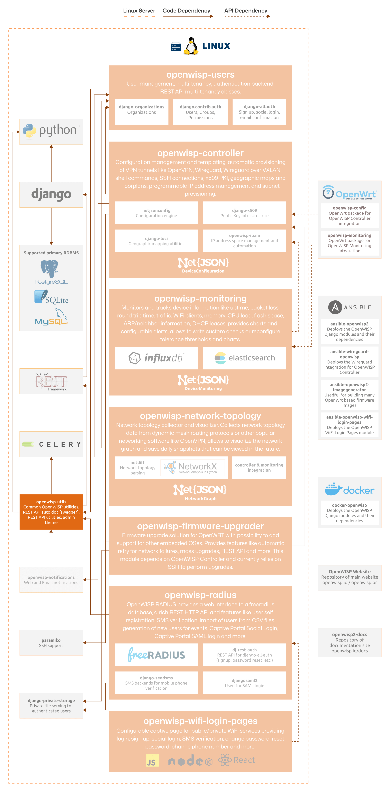

Developer Installation Instructions
===================================

.. include:: ../partials/developer-docs.rst

The following diagram illustrates the role of the Utils module within the
OpenWISP architecture.

    **OpenWISP Architecture: highlighted utils module**

.. important::

    For an enhanced viewing experience, open the image above in a new
    browser tab.

    Refer to :doc:`/general/architecture` for more information.

.. contents:: **Table of Contents**:
    :depth: 2
    :local:

Installing for Development
--------------------------

Install the system dependencies:

.. code-block:: shell

    sudo apt-get install sqlite3 libsqlite3-dev

    # For running E2E Selenium tests (Firefox is the default browser)
    sudo apt install firefox chromium

Fork the `openwisp-utils repository
<https://github.com/openwisp/openwisp-utils>`_ on GitHub, then clone your
fork. Replace ``YOUR_GITHUB_USERNAME`` with your GitHub username:

.. code-block:: shell

    git clone git@github.com:YOUR_GITHUB_USERNAME/openwisp-utils.git

Navigate into the cloned repository:

.. code-block:: shell

    cd openwisp-utils/

Setup and activate a virtual-environment (we'll be using `virtualenv
<https://pypi.org/project/virtualenv/>`_):

.. code-block:: shell

    python -m virtualenv env
    source env/bin/activate

Make sure that your base python packages are up to date before moving to
the next step:

.. code-block:: shell

    pip install -U pip wheel setuptools

Install development dependencies:

.. code-block:: shell

    pip install -e .[all]
    pip install -r requirements-test.txt
    sudo npm install -g prettier

Set up the git *pre-push* hook to run tests and QA checks automatically
right before the git push action, so that if anything fails the push
operation will be aborted:

.. code-block:: shell

    openwisp-pre-push-hook --install

Create database:

.. code-block:: shell

    cd tests/
    ./manage.py migrate
    ./manage.py createsuperuser

Launch development server:

.. code-block:: shell

    ./manage.py runserver

You can access the admin interface at ``http://127.0.0.1:8000/admin/``.

Run tests with:

.. code-block:: shell

    ./runtests

Run quality assurance tests with:

.. code-block:: shell

    ./run-qa-checks

Alternative Sources
-------------------

Pypi
~~~~

To install the latest Pypi:

.. code-block:: shell

    pip install openwisp-utils

Github
~~~~~~

To install the latest development version tarball via HTTPs:

.. code-block:: shell

    pip install https://github.com/openwisp/openwisp-utils/tarball/master

Alternatively you can install the latest development version from Git:

.. code-block:: shell

    pip install -e git+https://github.com/openwisp/openwisp-utils#egg=openwisp_utils
