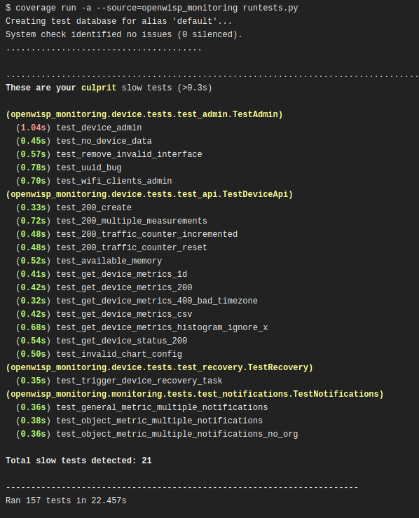

Test Utilities
==============

.. include:: ../partials/developer-docs.rst

.. contents:: **Table of Contents**:
    :depth: 2
    :local:

``openwisp_utils.tests.catch_signal``
-------------------------------------

This method can be used to mock a signal call in order to easily verify
that the signal has been called.

Usage example as a context-manager:

.. code-block:: python

    from openwisp_utils.tests import catch_signal

    with catch_signal(openwisp_signal) as handler:
        model_instance.trigger_signal()
        handler.assert_called_once_with(
            arg1="value1",
            arg2="value2",
            sender=ModelName,
            signal=openwisp_signal,
        )

.. _utils_time_logging_test_runner:

``openwisp_utils.tests.TimeLoggingTestRunner``
----------------------------------------------

This class extends the `default test runner provided by Django
<https://docs.djangoproject.com/en/5.2/ref/settings/#std:setting-TEST_RUNNER>`_
and logs the time spent by each test, making it easier to spot slow tests
by highlighting time taken by it in yellow (time shall be highlighted in
red if it crosses the second threshold).

By default tests are considered slow if they take more than 0.3 seconds
but you can control this with :ref:`OPENWISP_SLOW_TEST_THRESHOLD
<openwisp_slow_test_threshold>`.

In order to switch to this test runner you have set the following in your
`settings.py`:

.. code-block:: python

    TEST_RUNNER = "openwisp_utils.tests.TimeLoggingTestRunner"

``openwisp_utils.tests.capture_stdout``
---------------------------------------

This decorator can be used to capture standard output produced by tests,
either to silence it or to write assertions.

Example usage:

.. code-block:: python

    from openwisp_utils.tests import capture_stdout

    @capture_stdout()
    def test_something(self):
        function_generating_output()  # pseudo code

    @capture_stdout()
    def test_something_again(self, captured_ouput):
        # pseudo code
        function_generating_output()
        # now you can create assertions on the captured output
        self.assertIn("expected stdout", captured_ouput.getvalue())
        # if there are more than one assertions, clear the captured output first
        captured_error.truncate(0)
        captured_error.seek(0)
        # you can create new assertion now
        self.assertIn("another output", captured_ouput.getvalue())

**Notes**:

- If assertions need to be made on the captured output, an additional
  argument (in the example above is named ``captured_output``) can be
  passed as an argument to the decorated test method, alternatively it can
  be omitted.
- A ``StingIO`` instance is used for capturing output by default but if
  needed it's possible to pass a custom ``StringIO`` instance to the
  decorator function.

``openwisp_utils.tests.capture_stderr``
---------------------------------------

Equivalent to ``capture_stdout``, but for standard error.

Example usage:

.. code-block:: python

    from openwisp_utils.tests import capture_stderr

    @capture_stderr()
    def test_error(self):
        function_generating_error()  # pseudo code

    @capture_stderr()
    def test_error_again(self, captured_error):
        # pseudo code
        function_generating_error()
        # now you can create assertions on captured error
        self.assertIn("expected error", captured_error.getvalue())
        # if there are more than one assertions, clear the captured error first
        captured_error.truncate(0)
        captured_error.seek(0)
        # you can create new assertion now
        self.assertIn("another expected error", captured_error.getvalue())

``openwisp_utils.tests.capture_any_output``
-------------------------------------------

Equivalent to ``capture_stdout`` and ``capture_stderr``, but captures both
types of output (standard output and standard error).

Example usage:

.. code-block:: python

    from openwisp_utils.tests import capture_any_output

    @capture_any_output()
    def test_something_out(self):
        function_generating_output()  # pseudo code

    @capture_any_output()
    def test_out_again(self, captured_output, captured_error):
        # pseudo code
        function_generating_output_and_errors()
        # now you can create assertions on captured error
        self.assertIn("expected stdout", captured_output.getvalue())
        self.assertIn("expected stderr", captured_error.getvalue())

``openwisp_utils.tests.AssertNumQueriesSubTestMixin``
-----------------------------------------------------

This mixin overrides the `assertNumQueries
<https://docs.djangoproject.com/en/5.2/topics/testing/tools/#django.test.TransactionTestCase.assertNumQueries>`_
assertion from the django test case to run in a ``subTest`` so that the
query check does not block the whole test if it fails.

Example usage:

.. code-block:: python

    from django.test import TestCase
    from openwisp_utils.tests import AssertNumQueriesSubTestMixin

    class MyTest(AssertNumQueriesSubTestMixin, TestCase):
        def my_test(self):
            with self.assertNumQueries(2):
                MyModel.objects.count()

            # the assertion above will fail but this line will be executed
            print("This will be printed anyway.")

``openwisp_utils.tests.SeleniumTestMixin``
------------------------------------------

This mixin provides the core Selenium setup logic and reusable test
methods that must be used across all OpenWISP modules based on Django to
enforce best practices and avoid flaky tests.

It includes a built-in retry mechanism that can automatically repeat
failing tests to mitigate transient (flaky) failures. When a Selenium test
fails, it must pass 2 successful retry runs by default before it is
considered successful. You can customize this behavior using the following
class attributes:

- ``retry_max``: The maximum number of times to retry a failing test.
  Defaults to ``5``.
- ``retry_delay``: The number of seconds to wait between retries. Defaults
  to ``0``.
- ``retry_successes_required``: The number of successful retries required
  after a failure for the test to be considered as passed. Defaults to
  ``2``.
- ``retry_threshold``: Deprecated. Existing test suites can still use it
  to require a minimum ratio of successful retries.

**Example usage:**

.. code-block:: python

    from openwisp_utils.tests import SeleniumTestMixin
    from django.contrib.staticfiles.testing import StaticLiveServerTestCase

    class MySeleniumTest(SeleniumTestMixin, StaticLiveServerTestCase):
        retry_max = 10
        retry_delay = 0
        retry_successes_required = 3

        def test_something(self):
            self.open("/some-url/")
            # Your test logic here

.. _selenium_dependencies:

Selenium Dependencies
~~~~~~~~~~~~~~~~~~~~~

Running browser tests with Selenium requires that both ``geckodriver`` and
``chromedriver`` are installed locally.

1. Download the appropriate ``geckodriver`` and ``chromedriver`` for your
   OS and architecture (e.g., ``linux-64``).
2. Extract the downloaded files.
3. Make the programs available on your system by copying the executable
   files to a directory included in your ``PATH``. For example, on a
   typical Linux system, this could be ``/usr/local/bin/geckodriver`` and
   ``/usr/local/bin/chromedriver``.

The Python dependencies for running Selenium tests are included as extra
dependencies in ``openwisp-utils`` (``openwisp-utils[selenium]``). These
should be automatically installed when setting up the development
environment. All the OpenWISP modules using ``SeleniumTestMixin`` are
already depending on ``openwisp-utils[selenium]``.

Key Methods of ``SeleniumTestMixin``
~~~~~~~~~~~~~~~~~~~~~~~~~~~~~~~~~~~~

``setUpClass()`` (``@classmethod``)
+++++++++++++++++++++++++++++++++++

Initializes the Selenium WebDriver with either Firefox (default) or
Chrome.

Applies a number of settings by default to improve test reliability.

- Uses the ``SELENIUM_HEADLESS`` environment variable to determine whether
  to run in headless mode.
- Firefox-specific options:

  - Uses the ``GECKO_BIN`` environment variable to specify a custom
    Firefox binary location.
  - Uses the ``GECKO_LOG`` environment variable to enable GeckoDriver
    logging to ``geckodriver.log``.
  - Uses ``page_load_strategy = "eager"`` to start interacting with the
    page before it's fully loaded.
  - Disables hardware acceleration for improved stability
    (``gfx.webrender.force-disabled``, ``layers.acceleration.disabled``).
  - Increases script timeout (``dom.max_script_run_time = 30``).
  - Uses a free port for Marionette to support parallel test execution.
  - Captures browser console logs over WebDriver BiDi, since Firefox does
    not support the WebDriver ``get_log`` API. Logs emitted during page
    load are captured as well, and are retrieved via
    ``get_browser_logs()``.

- Chrome-specific options:

  - Uses the ``CHROME_BIN`` environment variable to specify a custom
    Chrome binary location.
  - Uses ``page_load_strategy = "eager"`` to start interacting with the
    page before it's fully loaded.
  - Adds flags: ``--ignore-certificate-errors``, ``--no-sandbox``,
    ``--disable-gpu``, ``--disable-dev-shm-usage``,
    ``--disable-features=VizDisplayCompositor``.
  - Uses a free remote debugging port to support parallel test execution.
  - Enables browser logging with ``goog:loggingPrefs`` to retrieve console
    logs via ``get_browser_logs()``.

``tearDownClass()`` (``@classmethod``)
++++++++++++++++++++++++++++++++++++++

Quits the Selenium WebDriver to clean up resources after the test class
has finished executing.

``open(url, html_container="#main-content", driver=None, timeout=5)``
+++++++++++++++++++++++++++++++++++++++++++++++++++++++++++++++++++++

- Opens a URL in the browser.
- Waits for the page to fully load before returning.
- Waits for the ``html_container`` element to be visible before
  proceeding.

``login(username=None, password=None, driver=None)``
++++++++++++++++++++++++++++++++++++++++++++++++++++

Logs into the Django admin dashboard.

- Defaults to using ``admin`` / ``password`` credentials.
- Navigates to ``/admin/login/`` and fills in the login form.

``get_browser_logs(driver=None)``
+++++++++++++++++++++++++++++++++

Returns all browser console logs captured for the current page.

This includes ``INFO``, ``WARNING`` and ``SEVERE`` entries, so tests which
only need to assert the absence of JavaScript errors should prefer
``get_browser_errors()``.

``get_browser_errors(driver=None)``
+++++++++++++++++++++++++++++++++++

Returns relevant ``SEVERE`` browser console entries only.

This helper filters known Firefox internal messages emitted in headless
environments, for example ``BackupService.sys.mjs``. Use this method when
a test needs to assert that a page did not emit JavaScript errors.

``find_element(by, value, timeout=2, driver=None, wait_for='visibility')``
++++++++++++++++++++++++++++++++++++++++++++++++++++++++++++++++++++++++++

Finds an element using Selenium's ``find_element`` method. Waits for the
element based on the specified ``wait_for`` condition (``visibility``,
``presence``).

``wait_for_visibility(by, value, timeout=2, driver=None)``
++++++++++++++++++++++++++++++++++++++++++++++++++++++++++

Waits until an element is visible.

``wait_for_invisibility(by, value, timeout=2, driver=None)``
++++++++++++++++++++++++++++++++++++++++++++++++++++++++++++

Waits until an element is no longer visible.

``wait_for_presence(by, value, timeout=2, driver=None)``
++++++++++++++++++++++++++++++++++++++++++++++++++++++++

Waits until an element is present in the DOM.

``wait_for(method, by, value, timeout=2, driver=None)``
+++++++++++++++++++++++++++++++++++++++++++++++++++++++

General method for waiting for an element based on a given condition. Uses
Selenium's ``WebDriverWait`` and Expected Conditions (``EC``).

If the timeout is reached, the test fails with a descriptive error
message.

``wait_until(condition, timeout=2, driver=None)``
+++++++++++++++++++++++++++++++++++++++++++++++++

Waits until a custom Selenium expected condition or callable returns a
truthy value. Returns that value and preserves Selenium's
``TimeoutException``, allowing tests to provide a domain-specific failure
message when needed.

All standard Selenium waits default to two seconds, so tests must omit the
``timeout`` argument in the normal case. Use ``timeout=5`` only for a
concrete external asynchronous boundary, such as WebSocket delivery,
geocoding, chart rendering, or a page navigation.

``wait_for_script(script, *args, timeout=2, driver=None)``
++++++++++++++++++++++++++++++++++++++++++++++++++++++++++

Executes ``script`` until it returns a truthy value. Positional arguments
are passed to Selenium as JavaScript arguments and the final script result
is returned. This method uses ``wait_until()`` internally and is useful
for waiting for JavaScript-managed UI state.

``assert_no_browser_errors(driver=None)``
+++++++++++++++++++++++++++++++++++++++++

Asserts that the current page has no relevant ``SEVERE`` browser console
entries. It uses ``get_browser_errors()`` and therefore applies the
mixin's configured ignored-message filtering.

``wait_for_admin_success_message(timeout=2, driver=None)``
++++++++++++++++++++++++++++++++++++++++++++++++++++++++++

Waits for Django admin's ``.messagelist .success`` confirmation message
and returns the matching element.

Focused test argument validation
--------------------------------

OpenWISP modules need a standard ``./runtests`` entry point for the `AI
reviewer
<https://github.com/openwisp/openwisp-actions#on-demand-ai-review>`_ to
run tests. For security, the entry point must limit the options it
accepts. To avoid duplicating this logic in each module,
``openwisp-utils`` provides shared test runner helpers.

The following example validates focused test labels and the ``-q`` and
``-v`` flags before passing the original arguments to nose2:

.. code-block:: python

    import sys

    import nose2

    from openwisp_utils.test.runner import (
        InvalidTestArgument,
        parse_test_arguments,
        validate_test_labels,
    )

    try:
        labels, _ = parse_test_arguments(sys.argv[1:], allowed_flags=("-q", "-v"))
        validate_test_labels(labels)
    except InvalidTestArgument as error:
        print(error, file=sys.stderr)
        sys.exit(2)

    nose2.discover()

For example, ``./runtests tests.test_parser.TestParser.test_parse`` runs
one test. Without a label, nose2 discovers the full suite.

Available options
~~~~~~~~~~~~~~~~~

``parse_test_arguments`` accepts:

- ``arguments``: the test labels and flags supplied to the entry point.
- ``label_pattern``: a compiled pattern for accepted test labels. The
  default accepts modules directly under ``tests``, such as
  ``tests.test_parser``, plus their test classes and methods.
- ``allowed_flags``: the exact flags the entry point accepts. No flags are
  allowed by default.
- ``require_label``: set this to ``True`` to reject a command without a
  test label. The default is ``False``.

It returns two lists: regular expression matches for the labels and the
accepted flags. Use ``match.group(0)`` to get a label. It raises
``InvalidTestArgument`` for unsupported input.

``compile_test_label_pattern`` builds a pattern for projects with a
different test layout. It accepts:

- ``module_roots``: packages containing ``test_*.py`` modules. The default
  is ``("tests",)``.
- ``exact_modules``: full test module names that do not follow that naming
  convention. The default is an empty tuple.
- ``allow_subpackages``: set this to ``True`` to accept test modules
  inside subpackages, such as ``tests.parsers.test_parser``. The default
  is ``False``.

Each of ``module_roots`` and ``exact_modules`` accepts one name or a list
of names.

List packages whose names start with ``test_`` explicitly in
``module_roots``, for example ``("tests", "tests.test_snmp")``. To accept
only exact modules, set ``module_roots=()``.

For example, django-x509 uses both kinds:

.. code-block:: python

    from openwisp_utils.test.runner import compile_test_label_pattern

    pattern = compile_test_label_pattern(
        module_roots=("django_x509.tests",),
        exact_modules=("openwisp2.sample_x509.tests",),
    )

Pass the resulting ``pattern`` as ``label_pattern`` to
``parse_test_arguments``.

``validate_test_labels(labels)`` checks that the requested modules exist,
that selected classes inherit from ``unittest.TestCase`` and contain
tests, and that selected methods are regular instance methods. Initialize
Django or another required framework before calling it. An import error
inside an existing test module remains visible.

For runners that select test files instead of Python labels:

- ``compile_test_file_pattern(roots, kind)`` builds a pattern for
  ``python``, ``lua``, or ``jest`` test files under the named directories.
  The defaults are ``roots=("tests",)`` and ``kind="python"``.
- ``parse_test_files`` accepts the arguments, a file pattern, and allowed
  flags. It rejects paths containing ``..``, symbolic links, and missing
  files. ``root`` selects the directory used to check files and defaults
  to the current directory. Run the test command from the same directory
  as ``root``: the returned matches contain the original relative paths.
  Set ``max_files`` to limit how many files can be selected, or
  ``require_exists=False`` when the underlying runner checks existence.
- ``TEST_CLASS_LABEL_PATTERN`` accepts class and test method names without
  a module prefix. The caller must check that the selected class is a
  test.

When passing validated files to Jest, include ``--runTestsByPath`` so Jest
uses exact paths instead of treating the arguments as regular expressions.

These checks limit which tests and flags can be selected. They do not make
the tests safe: test code and its configuration can still execute code.
Run untrusted pull request code in an isolated, unprivileged environment.
